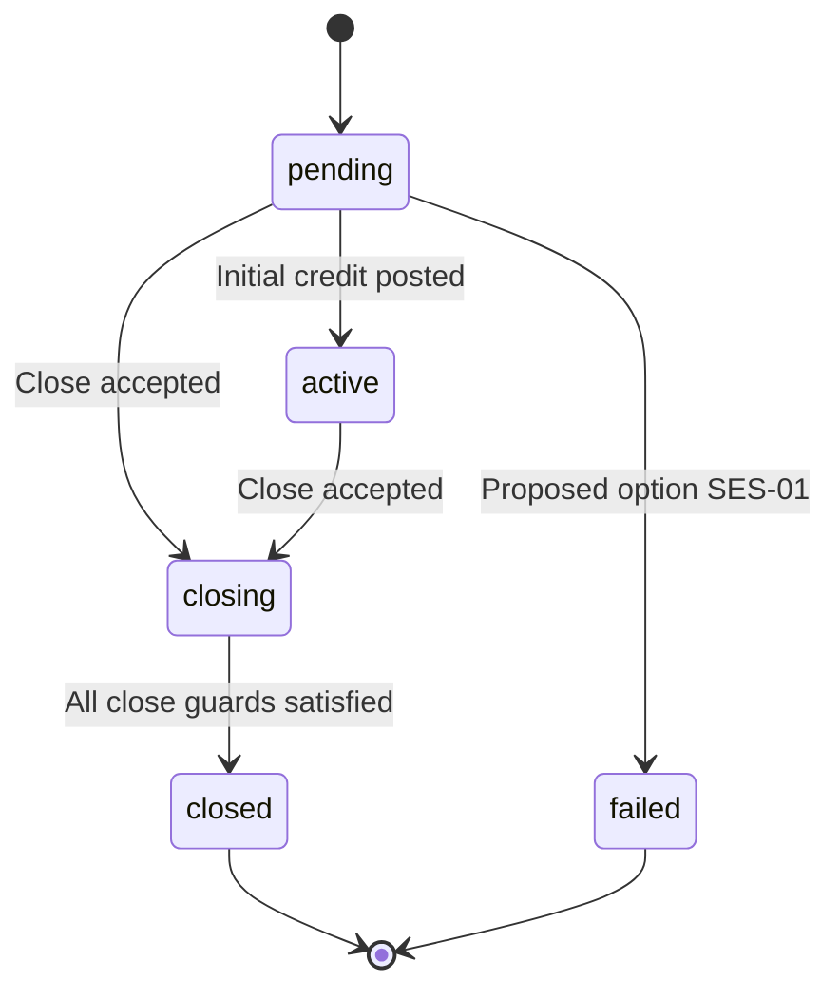

# Game Session Design — Issue #15

**Design draft — not implemented.**

This document records the two architecture reviews for Issue #15 and the subsequently approved business rules. Authorization to write this documentation does not approve the proposed schema, API, migration, or implementation. Session behavior is owned here; see the [wallet design](transfer-wallet-design.md), [schema](wallet-database-schema.md), [API draft](wallet-api-contract.md), and [unexecuted test plan](wallet-testing-strategy.md).

## Existing Implementation

The repository baseline is commit `87399d32a22d478a3ff93a0f7bb8d1a0f9f1b504`. Platform JWT and [Player Resolve](player-resolve-api.md) are implemented. Resolve identifies or creates an active player; it does not log the player in, issue a player credential, create a Game Session, change `last_login_at`, or move money. The existing Laravel `sessions` table stores HTTP sessions and is unrelated to this proposal.

`users` belongs to a platform and has a case-sensitive unique `(platform_id, external_user_id)`. There is no Game Session, Bet, Round, Payout, or Settlement implementation. The repository has no `users.balance`. Actual deployed database drift has not been inspected. Existing contracts remain unchanged, including [JWT validation](platform-jwt-authentication.md).

## Approved Business Rules

- At most one effective Session exists for a platform/player. `pending`, `active`, and `closing` all occupy that slot, enforced by MySQL uniqueness.
- Duplicate login returns the existing effective Session. It never replaces `closing` or implicitly initiates another debit.
- A Session becomes `active` only after its initial Transfer In is confirmed successful and locally posted. An active Session permits additional Transfer In.
- Closing stops new Transfer In and bets. Previously accepted inbound transfers and existing legal game obligations must finish before the final full-balance Transfer Out.
- Zero balance does not create a zero-value transfer. Closing finishes only with no unsettled obligations or unfinished money movement.
- Disabled platforms/players cannot start new business. Controlled settlement and money return must preserve existing obligations.
- `closed` and `failed` never reactivate. JWT expiry, HTTP timeout, and Worker lease expiry do not terminate a Session.

## Proposed Technical Design

### Lifecycle and Transition Table

All entries below are proposed enforcement details for the approved lifecycle. The `failed` decision remains [SES-01](#ses-01-initial-funding-failure).

| Current state | Event and guard | Result | Atomic local actions |
|---|---|---|---|
| None | New Create command, enabled owner/player, configured currency, no effective Session | `pending` | Create Session and saved command response |
| `pending` / `active` / `closing` | New duplicate-login command | Same Session | Save command response; no money movement |
| `pending` | Initial transfer remotely succeeds and local posting commits | `active` | Balance, Ledger, transaction success, activation time |
| `active` | Additional transfer posts | `active` | Balance, Ledger, transaction success |
| `pending` / `active` | Close accepted | `closing` | Fence new admissions and start draining |
| `closing` | Previously accepted Transfer In posts | `closing` | Credit locally; never reactivate; include in final balance |
| `closing` | Settlement sealed, all prior transfers resolved, balance and held amount zero | `closed` | Record terminal time, release effective slot |
| `closing` | Final Transfer Out locally posts and all close guards hold | `closed` | Debit, Ledger, hold capture, transaction success, terminal Session |
| `pending` | Initial transfer definitively fails, zero funds and no other responsibilities | Proposed `failed`, or remain `pending` | Decision pending; no automatic terminalization yet |
| `closed` / `failed` | New Create command | A new `pending` Session | Never update the old Session to an effective state |

Replay of a previously accepted command follows [API replay rules](wallet-api-contract.md#idempotency-and-replay), not the new-command guards in this table. For example, replay of the original initial Transfer In is not rejected merely because the Session is now active or closed.



### Effective Session Uniqueness

The [schema proposal](wallet-database-schema.md#game-sessions) defines a stored generated `effective_slot`: `1` for pending/active/closing and `NULL` for terminal states. `UNIQUE(platform_id, user_id, effective_slot)` allows multiple historical terminal rows but only one effective row. A status CHECK prevents an unknown spelling from bypassing slot membership. The composite player FK prevents a mismatched platform/player pair.

Concurrent Create commands also lock the owner/player using the common [lock order](transfer-wallet-design.md#row-lock-order). Only the exact expected Session unique-key conflict may be resolved by reading the winner; unrelated SQL failures propagate. Uniqueness remains the final defense even for another writer that does not use the service. Redis locks and application check-then-insert alone are insufficient.

Slot release depends on an explicit, validated terminal transition. Do not generate it from wall-clock expiry or a lease. A stalled effective Session remains recoverable and occupies its slot.

### Create and Duplicate Login

Create references a previously resolved player ID scoped to the verified PlatformContext. It creates `pending` without calling the platform wallet. Currency is derived from platform configuration, not chosen by the caller. A separate, explicit Transfer In supplies the initial amount.

A new login command returns the same effective Session regardless of whether it is pending, active, or closing. A retry with the original command identity returns its saved acceptance response, even if it references a Session that later terminated. A genuinely new login command after termination may create a new Session. This separates retry from new business intent.

No browser launch token, player authentication credential, heartbeat timeout, or device replacement feature is implied by this design.

### Initial Funding and Additional Funding

Proposed pending policy: permit at most one unresolved initial Transfer In; a different concurrent initial command returns a conflict. The same command replays. Active top-ups may coexist under per-player capacity reservations and permanent deduplication. See [capacity reservation](transfer-wallet-design.md#incoming-capacity-and-future-payouts).

A success observation alone does not activate the Session. Local credit, immutable Ledger entry, transaction success, and `activated_at` commit together. If Close won the lock first, a late initial credit stays in `closing` and must be returned through the close flow. No new Transfer In is accepted after closing.

### Closing and Terminal States

Close is an idempotent command. It atomically changes admission state before any final balance calculation. It must wait for all accepted inbound transfers, including unknown outcomes, and all existing legal game responsibilities. It then obtains a trusted settlement seal and rereads balance under locks before creating a full-balance outgoing intent and hold.

Once the final outgoing intent exists, ordinary new wallet credits/debits must not invalidate that snapshot. Valid replays produce no new posting. A previously unseen late settlement indicates a broken seal and requires investigation, not attribution to a later Session.

If booked balance is zero, held is zero, settlement is sealed, and no money movement remains unfinished, close without a transfer or Ledger entry. An outgoing unknown keeps `closing` and its hold. A definitive outgoing failure releases the hold but keeps `closing`; authorization for a replacement operation is an open recovery policy, [OPS-02](transfer-wallet-design.md#ops-02-replacement-after-definitive-failure).

`failed` must never mean timeout or abandoned money. The proposed `closed_at` name for failed termination is unresolved; see SES-02. Terminal states cannot reopen.

### Settlement Barrier and Trust Boundary

There are no existing game tables to query. These are requirements for a future trusted settlement provider, not implemented methods:

```text
stopAdmissions(session, fence)
drainExistingObligations(session, fence)
sealSettlement(session, fence) -> durable evidence
```

The provider must establish all of the following:

1. Bet acceptance and responsibility registration occur atomically with the same user/Session admission locks. No accepted but unregistered liability may be lost.
2. Closing establishes a monotonically identified admission boundary. All game writers must honor it, including queued work and retries.
3. Draining permits legitimate payout, refund, and cancellation for pre-boundary obligations, even after an owner/player is disabled.
4. Sealing proves all accepted responsibilities and their wallet postings are complete, not merely that a current count query is zero.
5. Evidence is durably attributable to an authorized provider and bound to platform, player, Session, fence, and settlement version. An opaque evidence ID alone is not proof.
6. Seal validation and the final outgoing snapshot share compatible locks/version checks; no new responsibility or posting may enter between them.
7. After sealing, duplicate settlement delivery is harmless. New liability or an unseen valid payout is an invariant violation requiring controlled handling.

The platform caller cannot assert `sealed`, submit an arbitrary fence, or certify its own payout. The generation, storage, and verification of fence evidence remain SES-03. Until a trusted provider exists, fail closed. A provider that certifies that gaming is completely disabled requires separate approval; absence of Bet tables is not evidence of zero responsibility.

### Concurrency and Failure Recovery

| Race or failure | Required behavior |
|---|---|
| Create versus Create | DB uniqueness selects one effective Session |
| Login versus initial funding | Login does not create a new debit |
| Close versus top-up acceptance | Lock winner determines acceptance; accepted top-ups are drained |
| Close versus bet | Same admission locks prevent acceptance after closing |
| Close versus payout | Preexisting legitimate settlement completes before seal |
| Seal versus outgoing snapshot | Shared fence/locks eliminate the inspection-to-action gap |
| Worker/JWT timeout | Keep effective Session; query/recover durable intent |
| Remote success followed by local crash | Recover posting before determining close eligibility |
| Disabled platform/player | Block new risk; controlled identity handles old obligations |

Illegal API transitions return a proposed `409 SESSION_STATE_CONFLICT` without a success event. Workers compare expected state/version; stale workers cannot overwrite newer decisions. Terminal evidence contradictions raise an alert and manual reconciliation. The complete money failure matrix belongs to the [wallet design](transfer-wallet-design.md#failure-matrix).

## External Platform Dependencies

Initial activation and final closure require trustworthy transfer outcomes from the [Gateway capabilities](wallet-api-contract.md#required-external-capabilities). No real platform endpoint, outbound authentication, query guarantee, or adapter is known. Unknown debit/credit results block corresponding progress rather than being guessed as failures.

## Open Questions

### SES-01 Initial Funding Failure

Option A terminates as failed after definitive failure only when no responsibility remains; a new login starts a new Session. Option B preserves pending and accepts a new explicit funding command after the old one definitively failed. Both preserve unknown transactions and forbid reuse of a failed business identity. Neither is approved. Operational age limits must not silently release the slot.

### SES-02 Terminal Timestamp Semantics

The schema draft retains the earlier `closed_at` candidate for both closed and failed, but this naming is not approved. Alternatives are a generic `terminated_at` or separate `failed_at`. Choose before migration/API finalization; no field rename is implemented here.

### SES-03 Settlement Fence and Evidence

Select the trusted provider, fence generation, durable evidence format, liability registry, and verification protocol. Bet/Payout/Settlement code and a no-gaming provider are not implemented or approved by writing this document.
