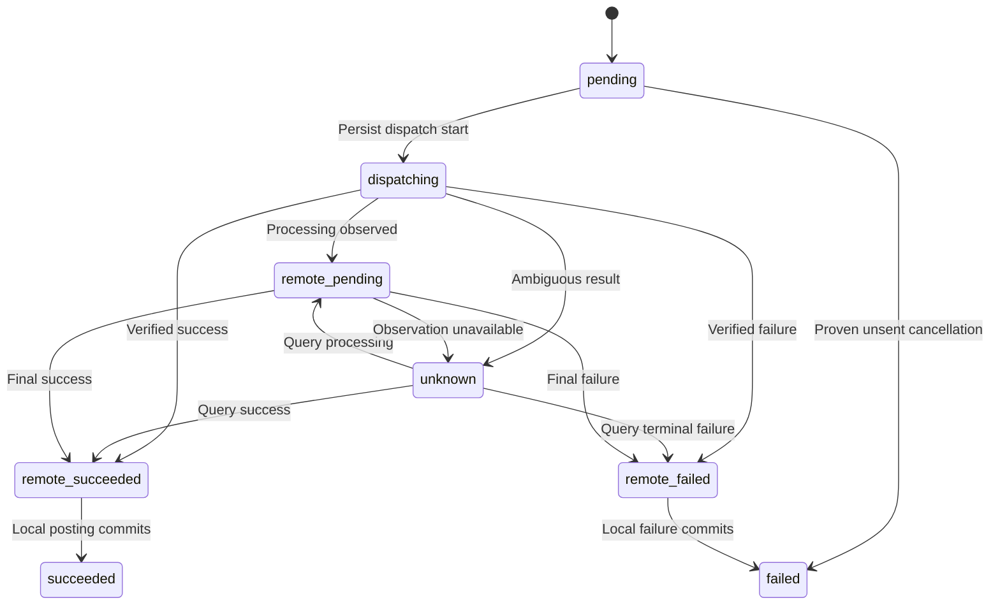
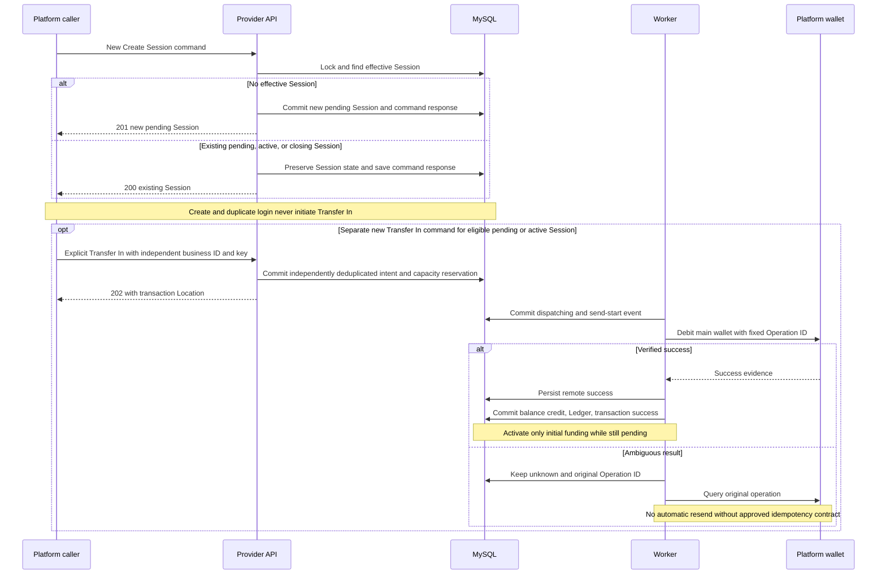
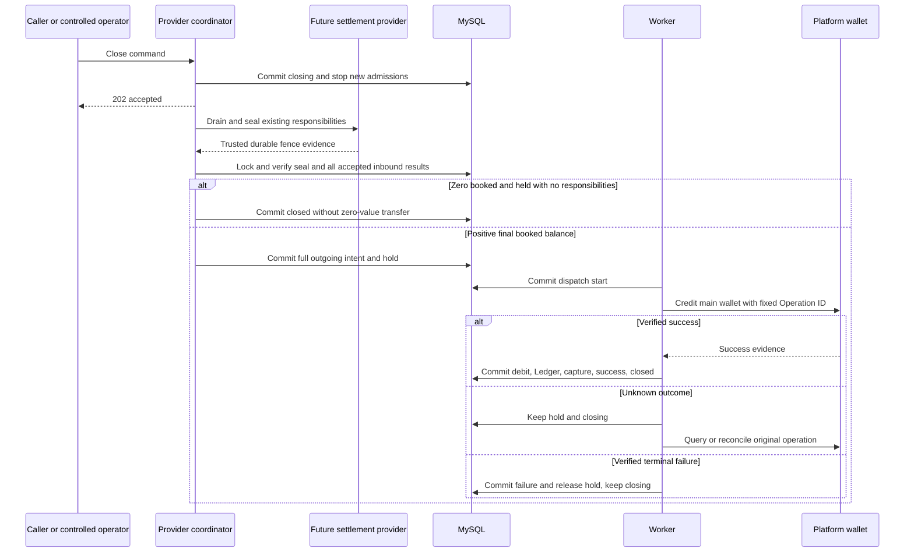

# Transfer Wallet Design — Issue #15

**Design draft — not implemented.**

This is the overview and recovery design from the two Issue #15 architecture reviews. Approved business rules are distinguished from proposed implementation choices. Documentation approval does not authorize implementation or migrations. Read the [Session design](game-session-design.md), [schema](wallet-database-schema.md), [API draft](wallet-api-contract.md), and [unexecuted testing strategy](wallet-testing-strategy.md) for their authoritative details.

## Existing Implementation

At baseline `87399d32a22d478a3ff93a0f7bb8d1a0f9f1b504`, [Platform JWT](platform-jwt-authentication.md), [Player Resolve](player-resolve-api.md), and its [rate limiting and maintenance](platform-api-operations.md) exist. Wallet transfers, `users.balance`, Ledger, Holds, Gateway adapters, Workers, game settlement, and wallet reconciliation do not.

Resolve's `platform_api_idempotencies` stores exact successful responses for 48 hours and permits expiry/reuse/controlled pruning. Its processing reservation does not commit independently of the player operation. Money movement needs a separately committed intent and permanent business deduplication; do not reuse Resolve's retention or cleanup lifecycle. Existing audit snapshots are not financial postings.

## Approved Business Rules

The platform owns the main wallet; the provider owns game balance and financial history. The provider actively calls the platform for both directions. Each platform has one fixed currency, with no FX. Money uses `DECIMAL(18,2)` and no PHP float arithmetic.

| Term | Meaning |
|---|---|
| Transfer In | Platform debits main wallet; provider credits game balance only after confirmed success |
| Transfer Out | Platform credits main wallet; provider debits game balance only after confirmed success |
| Booked balance | Proposed `users.balance`, the locally posted amount |
| Held amount | Sum of unresolved outgoing `wallet_holds` in `held` state |
| Available balance | Booked balance minus held amount |

Holds cannot exceed booked balance. Ordinary new debits and new hold creation must check Available Balance. Capturing an existing Transfer Out hold consumes funds already reserved for that transaction; it must not require Available Balance to cover the same amount again. Balance and append-only Ledger update together. MVP has no general Adjustment API; correction requires a new entry, never historical mutation. Closing rejects new funding and bets, drains accepted funding and game obligations, then returns the full final balance. Zero balance creates no zero-value transfer. Unknown outgoing results require query, reconciliation, or manual recovery, not direct repeat payment. Disabled owners/players retain existing settlement and return obligations.

## Proposed Technical Design

### Transaction Identity and Permanent Deduplication

| Identity | Responsibility |
|---|---|
| Internal transaction ID | Database relationships |
| Public transaction UUID | API lookup resource |
| Business Transaction ID | Permanent platform-scoped business deduplication |
| Idempotency-Key | API command retry identity within a versioned endpoint |
| Outbound Operation ID | Fixed external debit/credit identity, reused only under an approved recovery contract |
| Attempt/request ID | One transport attempt or query trace; never replaces Operation ID |

Proposed UUID formats, response snapshot retention, and same-business-ID/new-key behavior remain [API open questions](wallet-api-contract.md#open-questions). Identity, owner, direction, amount, currency, and operation reference become immutable after intent acceptance. A different payload with an existing key is a conflict. New keys cannot create a second financial operation for the same permanent business identity.

Permanent deduplication means the identity cannot authorize new movement after expiry. It does not require retaining every HTTP body and evidence file forever. Archival must preserve a non-reusable deduplication record; [OPS-01](#ops-01-retention-and-operational-ownership) covers retention and ownership. No financial cleanup is authorized.

### Wallet Transaction State Machine

The schema uses these proposed state names consistently:

| State | Meaning |
|---|---|
| `pending` | Durable local intent; no dispatch has been committed |
| `dispatching` | Dispatch start persisted; request may have reached platform |
| `remote_pending` | Platform reports nonterminal processing |
| `unknown` | No trustworthy final outcome |
| `remote_succeeded` | Trustworthy remote success captured; local posting may remain |
| `remote_failed` | Trustworthy terminal failure captured; local failure completion may remain |
| `succeeded` | Local balance/Ledger and hold effects committed |
| `failed` | Definitive non-success completed locally; any outgoing hold released |

| From | Event / guard | To | Local effects |
|---|---|---|---|
| None | Valid accepted command | pending | Intent, response; outgoing hold if applicable |
| pending | Worker commits dispatch ownership | dispatching | Start event, lease/version |
| pending | Proven never dispatched and authorized cancellation | failed | Release hold; no posting; cancellation policy OPS-03 |
| dispatching | Verified remote processing | remote_pending | Schedule query |
| dispatching | Timeout, ambiguous transport, crash recovery | unknown | Preserve operation and hold |
| dispatching / remote_pending / unknown | Verified success | remote_succeeded | Persist safe evidence |
| dispatching / remote_pending / unknown | Verified terminal failure | remote_failed | Persist safe evidence |
| unknown | Query reports processing | remote_pending | Keep unresolved |
| remote_pending | Observation becomes unavailable | unknown | Keep unresolved |
| remote_succeeded | Atomic local posting commits | succeeded | Balance, sequence, Ledger, capture, event |
| remote_failed | Local failure completion commits | failed | Release outgoing hold, event |
| succeeded / failed | Repeated consistent evidence | unchanged | No duplicate posting |

`reconciliation_status` is separate: none/due/checking/manual/resolved. Manual review is not financial success or failure. Contradictory terminal evidence must not overwrite a prior result using last-response-wins. A successful payment reversal, if supported later, is a separate verified operation.

### Durable Intent and Dispatch

Use three separate boundaries:

1. A short local DB transaction validates live policy, deduplicates, reserves funds/capacity, writes the intent and acceptance response, and commits.
2. A Worker commits `dispatching` and a send-start event, releases DB locks, then calls the external Gateway.
3. A new short local transaction records/verifies evidence and posts the result. Remote-success evidence may first commit independently so local posting is recoverable.

An external HTTP call is never inside a retried Laravel transaction closure. Database transactions cannot roll back the external wallet. Retry recognized DB deadlocks only around reentrant local work.

Proposed MVP work discovery polls durable transaction rows. A queue may accelerate wakeups but is not the only record of work. After-commit enqueue alone leaves a crash gap. A separate transactional outbox is a reasonable alternative if later approved; neither scheduler nor queue is implemented here.

### Row Lock Order

Proposed common order: platform -> key (ordinary authenticated admission only) -> user -> Session -> command/transaction -> hold -> Ledger/events. Lock multiple rows of one class in deterministic ID order. A discovery scan must not retain a transaction-row lock and then acquire platform/user locks in reverse order.

Existing Resolve remains platform -> key -> Resolve idempotency -> user. New wallet paths must not acquire the Resolve record after locking a user. Existing Admin player status mutations lock user and do not subsequently acquire platform. Preserve compatible order with platform/key-management writers.

Admission rechecks JWT expiry/key/platform/player after waits. Internal restoration of an already accepted responsibility uses an independently authorized identity, not an expired original JWT. Short platform-first locks conservatively preserve current behavior but serialize a platform's writers; throughput optimization needs its own lock review. No DB lock crosses external HTTP.

### Local Ledger Posting and Wallet Holds

For every local money change, lock user and the relevant Session/transaction, verify its expected state, compute decimal strings, and commit balance, wallet_sequence, a unique Ledger posting, transaction status, and required event together on the User connection.

Incoming success adds booked balance. Outgoing acceptance first creates a hold equal to the locked final balance; booked is unchanged and available falls. Outgoing confirmed success subtracts booked, writes Ledger, captures the hold, and may close the Session in that same transaction. Confirmed failure releases the hold with failure completion; it does not create a success Ledger entry. Unknown keeps the hold without TTL-based release.

Before capture, lock and verify the transaction, player, and hold using the common lock order. The hold must belong to the same transaction, platform, player, Session, and currency; its amount must match the transaction amount and its status must be `held`. Trustworthy remote-success evidence bound to the same operation is required.

Let B be Booked Balance, A the capture amount, and H_other the total amount of all other effective holds. Require `B >= A` and `B - A >= H_other`. Do not require `Available Balance >= A`. For example, Booked 100.00 with its own held reservation of 100.00 and Available 0.00 can legitimately capture to Booked 0.00, Held 0.00, and Available 0.00.

Commit the Booked Balance debit, wallet_sequence, unique Ledger posting, hold capture, transaction success, and required events together on the same connection and DB transaction. Do not release the hold in a separate transaction before posting. A failed capture validation or local rollback must not reclassify verified remote success as remote failure, release another transaction's hold, or trigger another external payment. Keep the original operation recoverable. A matching completed capture retry verifies the existing result and performs no second debit or posting.

`UNIQUE(transaction_id)` on Ledger is a final local posting defense, not permission to swallow all unique-key errors. On a recognized duplicate, verify the existing posting's complete immutable identity/amount/result; an inconsistency is an invariant violation. A crash rolls back all local effects together. Local exactly-once posting is a design goal protected by this protocol, not a claim of cross-system exactly-once delivery.

Ledger runtime access is SELECT/INSERT only. Review global, database, table, and role-derived grants and use a separate migration/maintenance identity: restrictive table grants do not cancel broader inherited privileges. No trigger or double-entry accounting is part of the default proposal. See [schema enforcement boundaries](wallet-database-schema.md#constraint-enforcement-boundaries).

### Incoming Capacity and Future Payouts

Let `M = 9999999999999999.99`, `B = booked`, and `R = sum of accepted unresolved Transfer In amounts`. Under the user lock, accept only if `B + R + new_amount <= M`. Calculate using wider exact decimal intermediates/BCMath, never float or a truncating PHP integer conversion.

R includes pending, dispatching, remote_pending, unknown, and remote_succeeded until the local posting commits. Remote_failed remains reserved until local failure completion. Posting moves the amount from R to B atomically; rejection/failure releases capacity only with a verified safe decision. Unknown cannot free capacity by timeout. Concurrent initial funding is proposed to serialize to one unresolved initial intent; active top-ups can reserve capacity independently.

Every future positive-credit writer must respect capacity already promised to incoming transfers. Payouts require an approved maximum-liability/reservation model before bets are enabled. Do not debit a platform and discover only afterward that the provider has no room to post. Exact liability accounting and whether explicit reservation storage is needed remain [CAP-01](#cap-01-capacity-and-game-liability). No Bet/Payout implementation is implied.

### Worker Lease and Crash Recovery

Use a lease token, lease_until, and monotonically checked version. Lease expiry permits recovery coordination, not a conclusion that the platform saw nothing. Recover expired dispatching as unknown and query the original Operation ID. A stale Worker cannot overwrite the active owner's state. Preserve its observation as evidence; the current owner can verify/query and apply it.

If an HTTP timeout races a successful response, recording unknown must not downgrade remote_succeeded/succeeded. Record send/query start and result separately; a crash may leave only the start event. Persist accepted work before responding, so lost API responses and Worker restarts do not create new business intent.

If COMMIT's response is lost, reconnect and read the permanent identity on the writer. Do not assume rollback, immediately issue a new debit, or trust a lagging replica. If remote success occurred before any result could be persisted, the durable dispatch intent and original Operation ID enable query recovery. Backups restored to an earlier local point require outbound suspension and external reconciliation before sending old pending work.

### Unknown Outcomes

Query/reconcile/manual resolution is the default. No automatic resend is enabled by this design. Only an explicitly reviewed platform contract guaranteeing idempotency over the recovery window may permit resending the original Operation ID and identical content. Lease expiry, retry exhaustion, 5xx, timeout, and eventually consistent not_found are not that authorization.

A verified response must match platform, external player, direction, amount, currency, and operation reference. An HTTP success status alone is insufficient. Unexpected partial success, fees, changed currency, or contradictory outcomes stop automatic processing. The Gateway contract must state whether those cases can exist.

### Reconciliation and Controlled Operations

Reconcile both local conservation and platform-to-provider movement. Use a consistent local snapshot for balance/Ledger/hold checks, then correlate platform records with permanent Operation IDs. Compare individual direction/amount/currency/results as well as totals; matching totals alone can hide missing and duplicate transfers.

Controlled operators may inspect, query, and attach verified evidence with a ticket and attributable identity. They cannot simply edit a transaction to failed to free funds, alter Ledger history, or invent a platform success. Role design, second-person review, owner, SLA, and evidence retention remain OPS-01. No permission is automatically granted.

Disabled platform/player handling separates new admission from existing responsibilities. Ordinary Platform JWT still rejects disabled platforms. Internal settlement/recovery authorization must permit only scoped existing obligations, use outbound provider credentials, and preserve evidence. It must not impersonate a valid platform request or open arbitrary new funding.

### Sequence Diagrams

The first diagram starts with a new Create command; a matching command replay returns its saved response. Any subsequent Transfer In is a separate explicit command, independently deduplicated and authorized. It is never a side effect of returning an existing Session.

### Failure Matrix

| Scenario | Recovery and forbidden shortcut |
|---|---|
| Duplicate login | Return effective Session; never implicit debit |
| Same key, changed content | Conflict; no second intent |
| Same business identity, different key | Deduplicate; response policy API-02 remains open |
| Concurrent top-ups near limit | User-locked capacity reservations prevent over-acceptance |
| Close races accepted funding | Wait for its definitive local completion before final outgoing snapshot |
| Close races bet/payout | Admission fence and trusted seal; do not rely on zero-row inspection |
| Platform 5xx/timeout | Unknown; no new Operation ID |
| Query not_found | Apply reviewed contract; do not infer unsent |
| Platform succeeded, local posting failed | Retry local posting or re-query; do not repeat external movement |
| Result persistence failed | Recover using dispatch intent and original operation |
| Worker crash after dispatch-start | Treat as potentially sent; query |
| Worker lease expired | Coordinate recovery, keep hold and effective Session |
| Ledger duplicate | Verify existing posting; do not swallow unrelated SQL errors |
| DB COMMIT response lost | Reconnect and inspect permanent identity on writer |
| API response lost | Original command replay; GET current status |
| Outgoing definitive failure | Release hold atomically, keep closing; replacement OPS-02 |
| Contradictory evidence | Freeze automatic transition, manual investigation |
| Late unseen payout after seal | Broken barrier; no blind posting into a new Session |
| Disabled owner/player mid-flight | Preserve accepted responsibility and controlled money return |
| Database restore | Suspend outbound work and reconcile against platform history |

### Invariants

These are required design properties to test, not verified production guarantees:

1. At most one effective Session per platform/player, with consistent platform/user/Session/currency references.
2. `0 <= held <= booked <= M`; available equals booked minus held.
3. Ordinary new debits and new holds respect Available Balance. Capture validates and consumes its own existing reservation without requiring the same Available Balance again, checks `B >= A` and `B - A >= H_other`, and preserves other effective holds. All positive credits respect reserved incoming/game capacity.
4. Initial successful local credit is required for activation; closing admits no new funding or bets.
5. Each successful financial transaction has exactly one matching local Ledger entry; failed/unresolved transfers have no success posting.
6. Ledger before/after/delta and per-player sequence are continuous; starting from verified zero, booked equals the sum of deltas.
7. Outgoing capture, Booked Balance debit, wallet_sequence, Ledger posting, transaction success, and required events commit together. No separate pre-release occurs. Definitive failure and release commit together; local capture failure never converts verified remote success into remote failure.
8. Unknown keeps its outgoing hold and incoming capacity, and never releases the effective Session slot by age alone.
9. Closing waits for accepted funding and game settlement; sealed means no new ordinary balance-changing work.
10. Closed requires zero booked/held, no unfinished transfers, and trusted sealed settlement. Failed requires no outstanding financial/game responsibility.
11. Permanent IDs are not recycled; Ledger corrections append new entries.
12. Local atomicity does not establish remote exactly-once effects or protection against arbitrary privileged SQL writers.

## External Platform Dependencies

The [API Gateway capability list](wallet-api-contract.md#required-external-capabilities) is authoritative. Real endpoints, outbound authentication, idempotency lifetime, query semantics, terminal outcomes, external-ID uniqueness, fees/partial outcomes, and reconciliation export remain unconfirmed. A real adapter is absent. Automatic send/recovery rollout is blocked until applicable contracts are reviewed.

## Implementation Dependencies

Suggested future stages, not created issues: approve contracts -> additive local schema/Money/posting -> Session commands -> durable intent/hold/Worker with a test stub -> trusted settlement barrier -> real adapter -> reconciliation/operations -> separately approved rollout. No stage or new issue is authorized by this document.

## Open Questions

| ID | Owner document / decision |
|---|---|
| SES-01 / SES-02 / SES-03 | [Session questions](game-session-design.md#open-questions): initial failure, terminal time, trusted barrier |
| DB-01 / DB-02 / DB-03 / DB-04 | [Schema questions](wallet-database-schema.md#open-questions): drift, currency, details, effective grants |
| API-01 / API-02 / API-03 | [API questions](wallet-api-contract.md#open-questions): encoding/paths, changed key, admission settings and unresolved disabled-player access |
| API-04 | [Close Transfer Discovery](wallet-api-contract.md#api-04-close-transfer-discovery): proposed public transaction reference and failed/replacement selection |
| EXT-01 / EXT-02 / EXT-03 | [External questions](wallet-api-contract.md#external-platform-dependencies): transport, outcomes/dedup, reconciliation |
| TEST-01 | [Test prerequisites](wallet-testing-strategy.md#open-questions): future execution/provisioning |

### CAP-01 Capacity and Game Liability

Approve the incoming reservation query/storage model and future payout liability reservation before enabling bets. Every potential credit must respect already promised capacity. This is not settled by choosing DECIMAL or adding a nonnegative CHECK.

### OPS-01 Retention and Operational Ownership

Choose evidence/payload retention, archival and permanent deduplication preservation, reconciliation owner/SLA, manual permissions, ticket/evidence requirements, and second-person approval. No financial pruning policy or live permissions are approved.

### OPS-02 Replacement After Definitive Failure

Define who may create a new full outgoing business operation after verified terminal failure and hold release. Require proof that the prior operation cannot later credit; preserve original history and link recovery evidence. Unknown is never eligible. Whether repeated Close can request such recovery remains unapproved.

### OPS-03 Unsent Cancellation on Disable or Close

Decide whether accepted but provably unsent pending funding is completed or safely cancelled when the player/platform is disabled or closing. Already dispatching work is potentially sent and must be resolved. Both choices must preserve the closing drain and original command identity.
