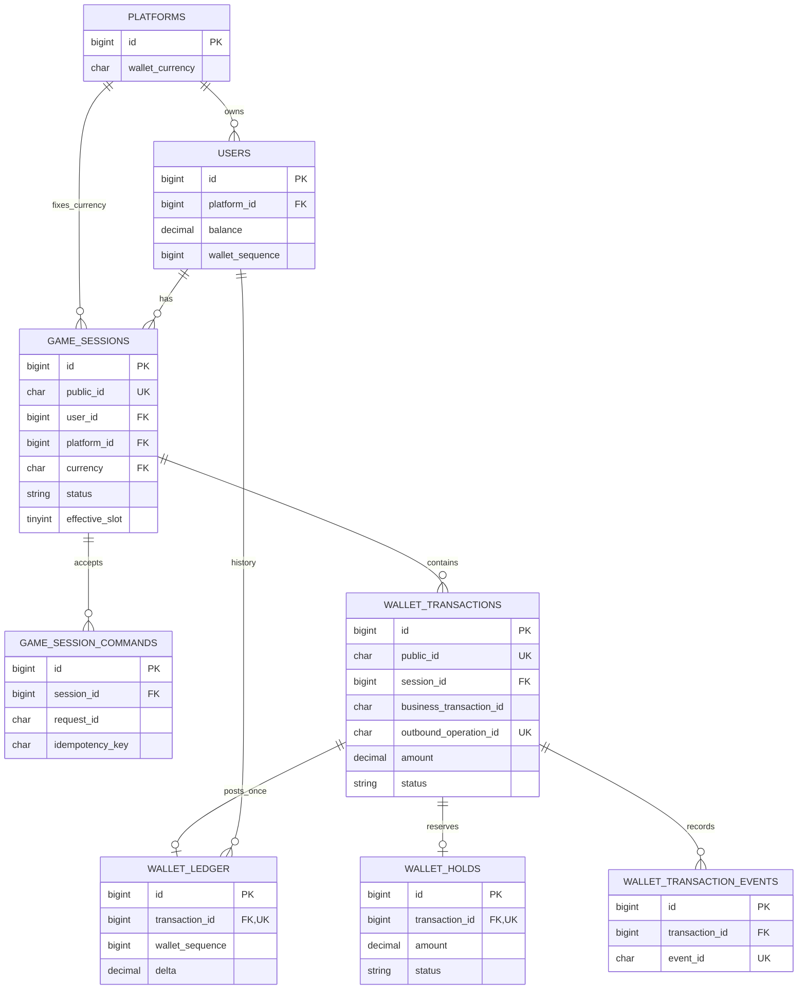

# Wallet Database Schema Proposal — Issue #15

**Design draft — not implemented.**

This is the authoritative proposed field/index/constraint inventory for the [Session design](game-session-design.md) and [wallet design](transfer-wallet-design.md). All additions below require separate technical approval and additive migrations. No migration file was created or executed for this documentation. [API fields](wallet-api-contract.md) and [unexecuted migration tests](wallet-testing-strategy.md#migration-tests) reference this inventory.

## Existing Implementation

Repository baseline `87399d32a22d478a3ff93a0f7bb8d1a0f9f1b504` has `platforms`, platform-owned `users`, JWT key tables, Resolve idempotency/limiter tables, and administrator audit storage. It has no `users.balance`, `users.wallet_sequence`, `platforms.wallet_currency`, or any of the new tables proposed here. Actual database schema and data were not queried.

The existing player schema has PK `users.id`, FK to `platforms.id`, and unique `(platform_id, external_user_id)` with case-sensitive external identity. Its exact-column test will need an authorized update when future schema implementation occurs. The existing Laravel HTTP `sessions` table is unrelated. Preserve all executed migrations and existing Resolve behavior.

## Approved Business Rules

Use `DECIMAL(18,2)`, no float arithmetic, one fixed currency per platform, booked balance with outgoing holds, append-only Ledger, and atomic balance/Ledger writes. Effective Session states are pending/active/closing and require DB uniqueness. History must not cascade-delete. No general Adjustment API, DB trigger, or double-entry accounting implementation is included. Exact columns, keys, currency provisioning, UUID formats, and migration mechanics below remain proposals.

## Proposed Technical Design

### Common Types and Naming

All new tables use InnoDB. IDs and FKs use `BIGINT UNSIGNED`. All proposed timestamps are UTC `DATETIME(6)`, explicitly written, with no implicit `ON UPDATE`. New UUIDs use `CHAR(36) CHARACTER SET ascii COLLATE ascii_bin`, canonical lowercase. Hashes use ASCII case-sensitive `CHAR(64)` with SHA-256 lowercase hexadecimal. Status/code strings use ASCII case-sensitive collation; evidence references/tickets use ordinary bounded strings and are not secret stores.

Currency uses `CHAR(3) CHARACTER SET ascii COLLATE ascii_bin`. A proposed check accepts exactly three uppercase ASCII letters; application validation also requires an approved supported-code list. This shape does not decide actual currency or provisioning.

In the tables below, `No` means NOT NULL; `—` means no DEFAULT and the writer supplies the value. Nullable fields default NULL. AUTO_INCREMENT applies only to new table primary IDs. CHECK names and index/FK names must be explicit and fit MySQL's identifier limits; logical names below are the review inventory, not generated migration files.

All new FKs use `ON DELETE RESTRICT ON UPDATE RESTRICT`. Parent composite keys are explicit UNIQUE keys with matching column order/type/collation. No reliance on nonstandard nonunique referenced keys, no FK checks disabled for deployment, and no financial history cascades.

Money maximum `M` is `9999999999999999.99`. Signed DECIMAL allows negative Ledger deltas; balances/amounts have separate checks. Validate precision before SQL to avoid silent rounding. Arithmetic intermediates must accommodate sums wider than a stored column; do not overflow while checking whether a result would overflow. No unsigned PHP integer cast or float conversion is allowed for unsigned IDs/amounts.

### Users Additions

**`users.balance` is a proposed addition, not an existing field.** Existing identity/status/name/timestamps remain unchanged.

| Column | MySQL type | Nullable | Default | Purpose |
|---|---|---|---|---|
| balance | DECIMAL(18,2) | No | 0.00 | Booked local balance |
| wallet_sequence | BIGINT UNSIGNED | No | 0 | Latest committed Ledger sequence |

- Retain PK `id`, existing platform FK, external identity unique, and existing indexes.
- Add UQ `users_platform_id_id_unique(platform_id,id)` for tenant-consistent child references.
- Add CHECK `users_balance_nonnegative`: `balance >= 0`.
- Never add balance to generic API mass assignment. A decimal-string cast/value object does not itself replace guarded posting services.
- No cached held aggregate is proposed. Lock user before changing holds or calculating current held/capacity totals.
- If the reviewed actual schema genuinely has no prior money, existing rows begin at zero with no invented opening transfer. A discovered balance column or nonzero legacy funds blocks this assumption under DB-01.

### Platform Currency Proposal

| Column | MySQL type | Nullable | Default | Purpose |
|---|---|---|---|---|
| wallet_currency | CHAR(3) ASCII ascii_bin | Yes | NULL | Fixed game-wallet currency; NULL means unconfigured |

- Retain PK `id` and all existing fields/contracts.
- Add UQ `platforms_wallet_currency_unique(id,wallet_currency)`.
- CHECK: currency is NULL or exactly three uppercase ASCII letters, using case-sensitive validation.
- A non-NULL child Session references `(id,wallet_currency)`, so an unconfigured platform cannot acquire a matching Session currency.
- Proposed nullable rollout avoids inventing defaults or changing the current Platform create API. Configure through a separately approved controlled process, then prohibit ordinary currency edits. Existing child FKs protect historical consistency but are not the sole immutability policy.
- Immediate NOT NULL after explicit population is an alternative under DB-02; no mass currency assignment or configuration API is authorized here.

### Game Sessions

Table: `game_sessions`.

| Column | MySQL type | Nullable | Default | Purpose |
|---|---|---|---|---|
| id | BIGINT UNSIGNED AUTO_INCREMENT | No | Generated | Internal PK |
| public_id | CHAR(36) UUID | No | — | External Session identity |
| platform_id | BIGINT UNSIGNED | No | — | Platform owner |
| user_id | BIGINT UNSIGNED | No | — | Player owner |
| currency | CHAR(3) ASCII ascii_bin | No | — | Fixed currency snapshot |
| status | VARCHAR(16) | No | pending | Lifecycle state |
| effective_slot | TINYINT GENERATED ALWAYS STORED | Yes | Expression | Effective-state uniqueness |
| version | BIGINT UNSIGNED | No | 0 | Transition/CAS version |
| settlement_state | VARCHAR(16) | No | unverified | unverified/draining/sealed |
| settlement_fence | BIGINT UNSIGNED | Yes | NULL | Proposed trusted admission boundary |
| settlement_evidence_id | VARCHAR(100) | Yes | NULL | Durable evidence reference, not proof by itself |
| activated_at | DATETIME(6) | Yes | NULL | Initial posting/activation |
| closing_at | DATETIME(6) | Yes | NULL | Admissions stopped |
| sealed_at | DATETIME(6) | Yes | NULL | Barrier completion |
| closed_at | DATETIME(6) | Yes | NULL | Candidate terminal time; failed semantics unresolved SES-02 |
| failure_code | VARCHAR(64) | Yes | NULL | Safe diagnostic code |
| created_at | DATETIME(6) | No | — | Creation |
| updated_at | DATETIME(6) | No | — | Last state update |

Keys and indexes:

- PK `(id)`; UQ `(public_id)`.
- UQ `game_sessions_effective_unique(platform_id,user_id,effective_slot)`.
- UQ `(id,platform_id,user_id,currency)` for composite children.
- IX `(platform_id,status,updated_at,id)` and `(user_id,created_at,id)`.
- FK `(platform_id,user_id)` -> `users(platform_id,id)`.
- FK `(platform_id,currency)` -> `platforms(id,wallet_currency)`.

Checks: status IN pending/active/closing/closed/failed; settlement_state IN unverified/draining/sealed; active implies activated_at IS NOT NULL; closing implies closing_at IS NOT NULL; closed/failed implies candidate closed_at IS NOT NULL; sealed implies fence/evidence/sealed_at all non-NULL. The failed timestamp check is conditional on SES-02, not approved DDL. These row checks cannot prove the settlement evidence or legality of every historical transition.

Generated expression:

```sql
CASE WHEN status IN ('pending','active','closing') THEN 1 ELSE NULL END
```

MySQL permits indexed generated columns and multiple NULL values under UNIQUE. The non-NULL effective slot arbitrates both concurrent inserts and transitions. No `NOW()`/expiry expression controls slot release. A state allowlist prevents misspelled effective states from evading uniqueness. See [Session semantics](game-session-design.md#effective-session-uniqueness).

### Wallet Transactions

Table: `wallet_transactions`. Financial identity is immutable after insertion; operational fields are mutable through constrained services.

| Column | MySQL type | Nullable | Default | Purpose |
|---|---|---|---|---|
| id | BIGINT UNSIGNED AUTO_INCREMENT | No | Generated | Internal Transaction ID / PK |
| public_id | CHAR(36) UUID | No | — | Public resource identity |
| platform_id | BIGINT UNSIGNED | No | — | Platform |
| user_id | BIGINT UNSIGNED | No | — | Player |
| session_id | BIGINT UNSIGNED | No | — | Session |
| currency | CHAR(3) ASCII ascii_bin | No | — | Transaction currency |
| kind | VARCHAR(24) | No | — | transfer_in / transfer_out in proposed MVP |
| purpose | VARCHAR(24) | No | — | initial / topup / close |
| business_transaction_id | CHAR(36) UUID | No | — | Permanent platform business identity |
| endpoint | VARCHAR(80) | No | — | Versioned command namespace |
| idempotency_key | CHAR(36) UUID | Yes | NULL | Inbound Transfer In retry identity |
| request_hash | CHAR(64) ASCII ascii_bin | No | — | Canonical immutable business content |
| outbound_operation_id | CHAR(36) UUID | Yes | NULL | Fixed remote identity; transfer CHECK requires it |
| gateway_contract_version | VARCHAR(50) | Yes | NULL | Reviewed adapter contract; required for transfers |
| external_transaction_id | VARCHAR(128) ASCII ascii_bin | Yes | NULL | Platform reference, uniqueness unconfirmed |
| amount | DECIMAL(18,2) | No | — | Positive magnitude |
| status | VARCHAR(24) | No | pending | Proposed transaction state |
| reconciliation_status | VARCHAR(16) | No | none | none/due/checking/manual/resolved |
| close_slot | TINYINT GENERATED ALWAYS STORED | Yes | Expression | Limits outstanding/successful close transfer |
| send_attempt_count | INT UNSIGNED | No | 0 | Outbound sends |
| query_attempt_count | INT UNSIGNED | No | 0 | Queries |
| next_action_at | DATETIME(6) | Yes | NULL | Worker scheduling |
| lease_token | CHAR(36) UUID | Yes | NULL | Current coordination owner |
| lease_until | DATETIME(6) | Yes | NULL | Coordination expiry |
| version | BIGINT UNSIGNED | No | 0 | Prevent stale state mutation |
| last_error_code | VARCHAR(64) | Yes | NULL | Sanitized result |
| accepted_response_status | SMALLINT UNSIGNED | Yes | NULL | Original API acceptance status |
| accepted_response_body | TEXT | Yes | NULL | Original emitted JSON bytes |
| completed_at | DATETIME(6) | Yes | NULL | Local terminal completion |
| created_at | DATETIME(6) | No | — | Intent creation |
| updated_at | DATETIME(6) | No | — | State update |

Keys and indexes:

- PK `(id)`; UQ `(public_id)`.
- UQ `(platform_id,business_transaction_id)`, permanent across endpoint namespaces.
- UQ `(platform_id,endpoint,idempotency_key)`; system-created outgoing transactions may use NULL keys.
- UQ `(outbound_operation_id)`.
- UQ `(session_id,close_slot)`.
- UQ `(id,platform_id,user_id,session_id,currency)` for Ledger/Hold children.
- IX `(status,next_action_at,id)`, `(reconciliation_status,next_action_at,id)`, `(session_id,status,id)`, `(platform_id,user_id,created_at,id)`, `(platform_id,external_transaction_id)`.
- FK `(session_id,platform_id,user_id,currency)` -> `game_sessions(id,platform_id,user_id,currency)`.

Checks:

- amount > 0.
- State IN pending/dispatching/remote_pending/unknown/remote_succeeded/remote_failed/succeeded/failed.
- Reconciliation allowlist as above.
- MVP legal pairs: transfer_in with initial/topup; transfer_out with close.
- Transfers require non-NULL outbound_operation_id and gateway_contract_version.
- Transfer In requires idempotency_key, response status 202, and non-NULL acceptance body. A separate Session command owns Close's response.
- succeeded/failed requires completed_at; nonterminal states keep it NULL.
- lease_token and lease_until are both NULL or both non-NULL.

`close_slot` expression:

```sql
CASE WHEN kind = 'transfer_out' AND status <> 'failed' THEN 1 ELSE NULL END
```

Including succeeded blocks another successful full outgoing operation on the same Session; verified failed operations retain history but release this slot. **close_slot is not complete outgoing safety**: services must still verify seal, final balance, exact hold, prior terminality, and authorized replacement. It cannot prove that a remote failed observation is truthful.

External Transaction ID remains indexed but not unique until EXT-02 establishes its scope. Local Operation ID remains unique. A future adapter may require a different external-ID length/charset or composite uniqueness; review before enabling it.

Future Bet/Payout/Correction transactions would complete locally without a remote operation; they require separately reviewed additive constraints and responsibility identities. They are not silently admitted by this MVP allowlist. No opening transaction is invented for verified-zero initialization; nonzero legacy funds require DB-01 resolution.

### Wallet Ledger

Table: `wallet_ledger`. One posting per successful transaction is the proposed MVP model.

| Column | MySQL type | Nullable | Default | Purpose |
|---|---|---|---|---|
| id | BIGINT UNSIGNED AUTO_INCREMENT | No | Generated | PK |
| transaction_id | BIGINT UNSIGNED | No | — | Posting identity |
| platform_id | BIGINT UNSIGNED | No | — | Platform |
| user_id | BIGINT UNSIGNED | No | — | Wallet owner |
| session_id | BIGINT UNSIGNED | No | — | Session |
| currency | CHAR(3) ASCII ascii_bin | No | — | Currency |
| entry_type | VARCHAR(24) | No | — | transfer_in / transfer_out in MVP |
| delta | DECIMAL(18,2) | No | — | Signed local balance change |
| balance_before | DECIMAL(18,2) | No | — | Previous booked balance |
| balance_after | DECIMAL(18,2) | No | — | New booked balance |
| wallet_sequence | BIGINT UNSIGNED | No | — | Owner-local posting sequence |
| correction_of_entry_id | BIGINT UNSIGNED | Yes | NULL | Reserved future correction reference |
| created_at | DATETIME(6) | No | — | Posting time |

- PK `(id)`; UQ `(transaction_id)`; UQ `(user_id,wallet_sequence)`.
- IX `(platform_id,created_at,id)`, `(session_id,id)`, `(correction_of_entry_id)`.
- FK `(transaction_id,platform_id,user_id,session_id,currency)` -> transaction composite UQ.
- FK correction_of_entry_id -> wallet_ledger.id, RESTRICT; future service must verify the same wallet and legal correction.
- CHECK delta <> 0; balance_before >= 0; balance_after >= 0; wallet_sequence > 0; balance_after = balance_before + delta.
- CHECK legal entry_type and sign (incoming positive, outgoing negative).
- Proposed MVP requires correction_of_entry_id IS NULL; correction policy/constraints are future scope, not a hidden Adjustment API.
- No updated_at. Services and runtime grants forbid updates/deletes; no trigger is proposed.

Amount magnitude/type must match the parent transaction; parent success and the entry commit atomically. These cross-row facts are service-enforced, not implied by the composite FK or CHECK. Future local event signs: Bet negative, Payout positive, Correction a new signed entry with evidence. Zero-value settlement may have a game event but no zero-value Ledger posting.

### Wallet Holds

Table: `wallet_holds`.

| Column | MySQL type | Nullable | Default | Purpose |
|---|---|---|---|---|
| id | BIGINT UNSIGNED AUTO_INCREMENT | No | Generated | PK |
| transaction_id | BIGINT UNSIGNED | No | — | Outgoing intent |
| platform_id | BIGINT UNSIGNED | No | — | Platform |
| user_id | BIGINT UNSIGNED | No | — | Owner |
| session_id | BIGINT UNSIGNED | No | — | Session |
| currency | CHAR(3) ASCII ascii_bin | No | — | Currency |
| amount | DECIMAL(18,2) | No | — | Reserved booked funds |
| status | VARCHAR(16) | No | held | held/captured/released |
| created_at | DATETIME(6) | No | — | Reservation time |
| resolved_at | DATETIME(6) | Yes | NULL | Capture/release time |

- PK `(id)`; UQ `(transaction_id)`.
- IX `(user_id,status,id)`, `(session_id,status,id)`.
- Transaction composite FK identical to Ledger's owner scope.
- CHECK amount > 0 and status allowlist.
- CHECK held implies resolved_at IS NULL; captured/released implies resolved_at IS NOT NULL.
- Services require parent transfer_out, matching amount, and user-locked `SUM(held) <= balance`. Amount/identity never change; only held -> captured or held -> released are legal.
- Capture belongs to successful debit/posting; release belongs to definitive failure. No TTL, automatic lease-based release, or cascade deletion.

### Wallet Transaction Events

Table: `wallet_transaction_events`, append-only state/transport evidence metadata.

| Column | MySQL type | Nullable | Default | Purpose |
|---|---|---|---|---|
| id | BIGINT UNSIGNED AUTO_INCREMENT | No | Generated | PK |
| transaction_id | BIGINT UNSIGNED | No | — | Parent operation |
| event_id | CHAR(36) UUID | No | — | Event deduplication |
| event_type | VARCHAR(50) | No | — | intent_created/send_started/send_result/query_started/query_result/posted/failed/manual_evidence |
| attempt_id | CHAR(36) UUID | Yes | NULL | One outbound call/query |
| request_id | CHAR(36) UUID | Yes | NULL | Transport trace |
| actor_type | VARCHAR(16) | No | — | platform/worker/operator |
| actor_reference | VARCHAR(100) | No | — | Trusted attribution, never credentials |
| from_status | VARCHAR(24) | Yes | NULL | Previous state |
| to_status | VARCHAR(24) | Yes | NULL | Resulting state |
| observed_result | VARCHAR(24) | Yes | NULL | succeeded/failed/pending/unknown/not_found |
| result_code | VARCHAR(64) | Yes | NULL | Sanitized adapter/domain result |
| http_status | SMALLINT UNSIGNED | Yes | NULL | Transport status, not payment success |
| evidence_reference | VARCHAR(200) | Yes | NULL | Controlled evidence location |
| ticket | VARCHAR(100) | Yes | NULL | Manual change/review ticket |
| created_at | DATETIME(6) | No | — | Observation/transition time |

- PK `(id)`; UQ `(event_id)`; UQ `(transaction_id,attempt_id,event_type)`.
- IX `(transaction_id,id)` and `(created_at,id)`.
- FK transaction_id -> wallet_transactions.id.
- CHECK event_type/actor_type/observed_result allowlists; from/to state allowlists or NULL; http_status NULL or 100–599. Manual-evidence events require ticket and evidence reference under the proposed service policy.
- No updated_at, raw HTTP payload/JWT, or success assumptions from status code. A call writes separate start/result events; crash may leave only start. Evidence is validated before a financial transition.

### Game Session Commands

Table: `game_session_commands`, separate from prunable Resolve response records. Create/Close can exist without a money transaction.

| Column | MySQL type | Nullable | Default | Purpose |
|---|---|---|---|---|
| id | BIGINT UNSIGNED AUTO_INCREMENT | No | Generated | PK |
| platform_id | BIGINT UNSIGNED | No | — | Tenant scope |
| user_id | BIGINT UNSIGNED | No | — | Player |
| session_id | BIGINT UNSIGNED | No | — | Command result Session |
| currency | CHAR(3) ASCII ascii_bin | No | — | Composite scope |
| endpoint | VARCHAR(80) | No | — | Versioned create/close namespace |
| request_id | CHAR(36) UUID | No | — | Permanent command identity |
| idempotency_key | CHAR(36) UUID | No | — | Retry key |
| request_hash | CHAR(64) ASCII ascii_bin | No | — | Canonical input and target hash |
| response_status | SMALLINT UNSIGNED | No | — | Original accepted HTTP status |
| response_body | TEXT | No | — | Exact emitted JSON bytes |
| created_at | DATETIME(6) | No | — | Command acceptance |

- PK `(id)`; UQ `(platform_id,request_id)`; UQ `(platform_id,endpoint,idempotency_key)`; IX `(session_id,id)`.
- FK `(session_id,platform_id,user_id,currency)` -> Session composite UQ.
- CHECK endpoint IN `v1.platform.game-sessions.create`, `v1.platform.game-sessions.close` and response_status IN 200/201/202 with endpoint-specific accepted pairs.
- Insert atomically with the accepted Session action, without a separately committed processing placeholder. No updated_at or reusable TTL; original responses are immutable through the service. Snapshot retention/archival still requires OPS-01.
- Transfer In acceptance snapshots live in wallet_transactions with namespace `v1.platform.game-sessions.transfer-ins`; internally created close transfers use `v1.internal.game-sessions.close-transfer`.

### ERD



The diagram summarizes relationships; composite key order and scope are defined in the inventories above, not by simplified ERD attribute markers.

### Constraint Enforcement Boundaries

DB constraints enforce tenant/currency references, effective Session uniqueness, local posting uniqueness, and single-row arithmetic/state shape. They do not prove trusted external success, hold sums, funding capacity, ledger continuity across rows, legal historical transitions, settlement completeness, or cross-system atomicity. Enforce those through compatible user/Session locks, constrained services, evidence validation, and reconciliation.

Runtime Ledger/events privileges are proposed SELECT/INSERT only. Audit all effective global/database/table grants and inherited roles: a broad existing grant defeats a narrow table policy. Use separate migration and controlled test-maintenance credentials; do not add production DELETE merely for fixture cleanup. Privileged DB administrators remain a trust boundary. No database-enforced tamper-proof claim, trigger, or double-entry general ledger is made.

### Illustrative Laravel Migration Design

The following fragments only show additive intent and compound constraints. They are incomplete, unexecuted examples, not ready-to-run migration files. Final types/checks, SES-02, and a concrete deployment plan require approval. Existing migrations must not be edited.

```php
Schema::table('users', function (Blueprint $table): void {
    $table->decimal('balance', 18, 2)->default('0.00');
    $table->unsignedBigInteger('wallet_sequence')->default(0);
    $table->unique(['platform_id', 'id'], 'users_platform_id_id_unique');
});

DB::statement(
    'ALTER TABLE users ADD CONSTRAINT users_balance_nonnegative CHECK (balance >= 0)'
);

Schema::table('platforms', function (Blueprint $table): void {
    $table->char('wallet_currency', 3)
        ->charset('ascii')->collation('ascii_bin')->nullable();
    $table->unique(['id', 'wallet_currency'], 'platforms_wallet_currency_unique');
});

// Inside a future game_sessions definition, after defining status and owner fields:
$table->tinyInteger('effective_slot')->nullable()->storedAs(
    "CASE WHEN status IN ('pending','active','closing') THEN 1 ELSE NULL END"
);
$table->unique(
    ['platform_id', 'user_id', 'effective_slot'],
    'game_sessions_effective_unique'
);
$table->foreign(['platform_id', 'user_id'], 'game_sessions_player_fk')
    ->references(['platform_id', 'id'])->on('users')
    ->restrictOnDelete()->restrictOnUpdate();
```

Do not silently skip an existing column using hasColumn and assume compatibility: inspect type, default, data, constraints, and migration history first. No migration command is provided for execution in this documentation task.

### Migration Risks and Deployment Order

Future order: authorize actual-schema inventory -> resolve DB-01 and currency decisions -> additive users/platform keys -> game_sessions -> wallet_transactions -> Ledger/Holds/events/commands -> effective privilege provisioning -> separately authorized testing -> deployment with feature disabled -> approved configuration/adapter/barrier -> staged enablement and monitoring.

Review lock duration, table size, index builds, CHECK validation, and MySQL DDL behavior. A Laravel transaction does not make every DDL step rollbackable. No fresh/refresh/reset, destructive seeders, legacy migration edits, development-data resets, or forced confirmation bypasses. Nonempty financial table rollback must refuse destructive drops without a separately reviewed data/recovery operation. Prefer forward repair and disabling new admissions while recovery remains available.

Existing zero-money rows can receive default zero only after drift is excluded. Nonzero legacy money requires approved mapping, consistent opening evidence/postings, and writer control; do not manufacture historical transfers. Preserve player identity/status/relationships and existing tokens/audit/Resolve records. No migration has been applied in any environment for Issue #15.

## External Platform Dependencies

External-ID scope, length, currency rules, partial outcomes, and permanent operation/query semantics depend on [EXT-01 through EXT-03](wallet-api-contract.md#external-platform-dependencies). Required local keys do not establish external deduplication. Schema changes for a concrete adapter need another review.

## Open Questions

### DB-01 Actual Schema and Opening Money

Authorize later read-only deployed-schema inventory and resolve any existing balance/data drift before migration. Default zero is not permission to discard real funds. No actual DB inspection occurred here.

### DB-02 Currency Configuration

Approve wallet_currency naming, nullable rollout, supported codes, actual per-platform values, initial configuration authorization, and fixed-currency enforcement. No default currency or provisioning endpoint is assumed.

### DB-03 Exact Schema and Migration Approval

Approve the detailed columns/keys/checks and extra game_session_commands table, UUID/collation choices, external-ID storage after adapter review, and deployment/rollback plan. Resolve [SES-02](game-session-design.md#ses-02-terminal-timestamp-semantics) before finalizing terminal-time DDL. This document is not migration execution approval.

### DB-04 Effective Runtime Privileges

Inventory actual effective grants/roles and approve separate runtime, migration, recovery, and test-maintenance privileges. Ledger/events append-only access is not established by documentation or service convention alone.
